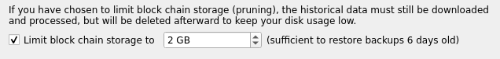
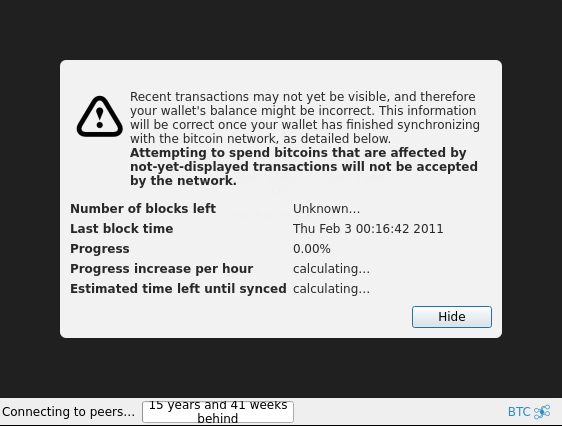

# Run your first Bitcoin node

You can run Bitcoin Roots on a desktop or laptop. All you need to get started is the app, disk space and an internet connection. You can run a node without creating a wallet or owning any bitcoin.

## Download Bitcoin Roots

Choose a package from the **v32.1-roots.2** release. The [release page](https://github.com/LuganoPlanB/bitcoin-roots/releases/tag/v32.1-roots.2) lists the signed checksums for verifying your download.

### Windows

Download the [Windows ZIP](https://github.com/LuganoPlanB/bitcoin-roots/releases/download/v32.1-roots.2/bitcoin-roots-windows-x86_64.zip) for a 64-bit Intel or AMD computer. Choose **Extract All**, then open `bitcoin-qt.exe` in the `bin` folder.

### macOS

Open **Apple menu → About This Mac**. If you see an Apple M-series chip, download the [Apple silicon ZIP](https://github.com/LuganoPlanB/bitcoin-roots/releases/download/v32.1-roots.2/bitcoin-roots-darwin-arm64.zip). If you see Intel, choose the [Intel Mac ZIP](https://github.com/LuganoPlanB/bitcoin-roots/releases/download/v32.1-roots.2/bitcoin-roots-darwin-x86_64.zip). Unzip it, move `Bitcoin-Qt.app` to Applications and open it.

### Linux

Choose the [Linux x86_64 archive](https://github.com/LuganoPlanB/bitcoin-roots/releases/download/v32.1-roots.2/bitcoin-roots-linux-x86_64.tar.gz) for an Intel or AMD computer, or the [Linux ARM64 archive](https://github.com/LuganoPlanB/bitcoin-roots/releases/download/v32.1-roots.2/bitcoin-roots-linux-aarch64.tar.gz) for a 64-bit ARM system. If you’re unsure, `uname -m` shows which one you have. Extract the archive and open `bitcoin-qt` in the `bin` folder.

## Choose a drive and a storage limit

On first launch, Roots asks where to store its data. Keep the default folder or choose a folder on another drive. If you already run a Bitcoin node, choose a **new, empty folder** for this one.

- **Keep the whole blockchain** if you want to serve old blocks to other nodes. Leave **Limit block chain storage to** unchecked. The welcome screen estimates how much space you need today. Leave room for the chain to grow.
- **Turn on pruning** if disk space is tight. Check **Limit block chain storage to** and choose how much block data to keep. Roots still downloads and checks the full history, then deletes older blocks. Leave extra space for the node’s other files.

If you later want the full history, or need to rescan an old wallet beyond the blocks you kept, you’ll need to download those blocks again.

## Let the first sync run

Click **OK**. Roots connects to other Bitcoin nodes and starts checking blocks from the beginning of Bitcoin’s history. This first sync can take days, depending on your connection, drive and computer. If your internet plan has a data cap, budget for the full download even with pruning on.

At first the window may say **Unknown** or **calculating**. You can hide it and click the progress bar at the bottom to see it again. If you need to turn off your computer, quit Roots and let it finish shutting down. It picks up where it left off the next time you open it.

Once your node is up to date, it checks new blocks as they arrive. If you use the built-in wallet, wait for sync to finish before relying on the balance it shows.

### Other ways to run Roots

Build instructions are available for [Linux](/doc/build-unix), [macOS](/doc/build-osx), [Windows](/doc/build-windows), [FreeBSD](/doc/build-freebsd), [NetBSD](/doc/build-netbsd) and [OpenBSD](/doc/build-openbsd). For a node without a desktop, see the [configuration guide](/doc/bitcoin-conf).
