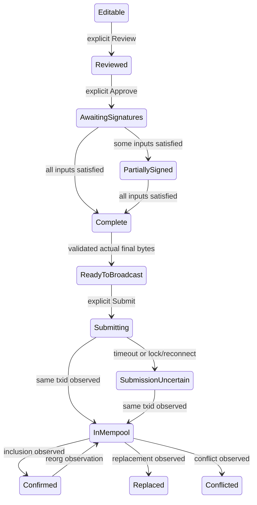

# RPC wallet architecture

`roots-gui` is a standalone C++20 desktop consumer of authenticated JSON-RPC.
It neither starts nor embeds a daemon. No Core library, internal header, Qt
wallet interface, IPC, database, chainstate, block-file or P2P access crosses
this boundary. Cookie files supply authentication only. One wallet tab binds
one daemon wallet; transaction documents have independent identities/revisions.
`AccountId` is reserved for a future real account service and is unused here.

The UI thread owns ImGui, presentation and document commands. Services own
bounded worker queues, cancellation and immutable result delivery. RPC/protocol,
storage, signer and platform adapters implement their respective boundaries.
The domain imports only the C++ standard library. There is no generic event bus
or plugin framework. Source, fixtures and consumer build integration stay here.

## Exact domain

`domain/model.h`, `money.cpp` and `workflow.cpp` implement the initial contract.
`Money` holds signed int64 satoshis, including signed deltas and both int64
extremes; transaction/coin amounts and their totals additionally lie in
0..2,100,000,000,000,000 satoshis. Arithmetic returns an empty optional on
overflow. User BTC input accepts at most eight fractional digits and one
explicit decimal separator (`.` or `,`); whitespace, grouping, exponent notation
and plus signs are rejected. Output uses a locale-independent dot and eight
digits. JSON number tokens support the JSON decimal/exponent grammar and exact
rescaling, including removable trailing zeroes; fractional satoshis are rejected.
Inputs are bounded to 128 characters. No approval value passes through double.

`FeeRate` is a reduced rational in sat/vB, with an int64-bounded nonnegative
numerator and uint32 nonzero denominator. Decimal input has up to eight digits.
`Fee(vsize)` rounds up once to whole satoshis and rejects overflow. Actual
post-finalization fee rates must be derived from the actual fee/vsize ratio.
Fiat and chart coordinates may become approximate only outside this model.

Balances have two separate axes: confirmed/unconfirmed/immature and
spendable/frozen/reserved/unavailable. Availability is mutually exclusive;
confirmed already includes its frozen/reserved coins. Never add the axes.
Duplicate outpoints, negative amounts, supply overflow and immature-spendable
claims are rejected. Unknown amounts propagate to affected totals, never zero.
Frozen preferences, owned draft reservations and daemon locks have different
owners; the scoped inventory and coin-control services reconcile them without
unlocking another application's coins. See [coin controls](coin-controls.md).

## Identity, freshness and locking

Every request/result carries backend session, network genesis, wallet, document,
draft revision and lock epoch. Identity wrappers reject empty/control-bearing
IDs; outpoints use validated 32-byte hex hashes and uint32 indices. A result
applies only to its exact current stamp while unlocked. Reconnect changes session
and revision; relevant draft edits increment revision. Neither counter wraps.
Cached/stale/offline/unknown provenance never becomes live merely by matching a
stamp; live provenance also needs an observation time. Persistent cached data
will retain its original observation time, height and network identity.

Privacy lock increments the epoch, hides draft/finalization access and revokes
pre-submission approval. Services must cancel local waits and clear UI/edit,
tooltip, clipboard-preview and accessibility content. Late results remain
rejected after unlock. Epoch exhaustion fails closed and cannot unlock.
Lock during submission records uncertainty. This is independent of metadata
encryption and daemon `walletlock`: no local cancellation proves cancellation
of a request accepted remotely. The model never invokes daemon locking.

## Transaction lifecycle

Review is inspection; approval is a separate command and does not sign.
`ApprovalIdentity` binds network/wallet, ordered outpoints/outputs, scripts,
amounts, sequences, version, locktime, all known prevouts, wallet policy,
descriptor-derived change evidence and explicit per-input sighash. Unknown
prevouts permit inspection, never approval/completion. Imported PSBT flags are
not change proof. Labels/fingerprints/container hashes are not transaction
identity. Relevant edits revoke approval, signatures and finalization; metadata
labels live outside this identity. Submitted documents cannot be edited into
another transaction. Replaced/conflicted states remain inspectable and terminal
for that document; an explicit new document owns any replacement construction.

Per-input satisfaction comes from the protocol verifier. Unknown/missing inputs
cannot produce Complete. The protocol adapter must recalculate txid/wtxid,
serialized size, vsize and fee from final bytes before `RecordFinalization`;
the model additionally rejects inconsistent fee/size/state. Its synthetic unit
fixtures do not establish cryptographic correctness. A timeout cannot transition
back to ReadyToBroadcast or automatically resend/sign/create a replacement.
Reconciliation observes the same txid, including already-confirmed results.

## Side-effect boundaries

Domain commands have no external effects. Service commands in
`tests/fixtures/contracts.json` classify their later effects explicitly:
observations; local metadata/preferences; daemon stateful mutations; signing;
finalization; submission; optional external services. Allocation, create/import
and signing can finish after local cancellation: record uncertainty and observe
the result before offering a retry. No draft/review/enrichment path calls
`sendtoaddress`, `sendmany` or `bumpfee`; enrichment uses explicit
`walletprocesspsbt(sign=false, finalize=false)`, signing true/false, finalization
its own command. Funding results require independent recipient/change/fee/input
constraint verification before adoption.

## Dependency register

| Boundary | Candidate and adoption status | Evidence owner |
| --- | --- | --- |
| Wallet protocol | libwally-core 1.6.1 f7b0a15b8d6fc79a5c4ed0123955dd482934483e + recorded PSBT conformance patch; pinned vendored public-data APIs qualified in [provider contract](provider-contracts.md) | contracts-providers |
| UI components | ImKit 986d8d286a74fb7b2f724b9ef5d008af139aa887 and compatible ImGui 367b2c24f399988ddafc0bb4628da0106bcc09be; core-only consumer and [standalone/parent build targets](build.md) qualified; production Linux bootstrap qualified on owned virtual display, see [platform ledger](native-platform.md) | build-pins/build-target/build-platform |
| Host | GLFW 3.5.1 d9d6f0f1f967807ffade6598ea9a631ebaf37a56 + matching official OpenGL3 backend; production X11/Mesa native lifecycle qualified on owned virtual display; physical hosts remain unqualified | build-pins/build-platform |
| HTTP/TLS/proxy | libcurl 8.23.0 exact archive in ui-lock; static HTTP/HTTPS/OpenSSL, cancellable authenticated connection/capability/refresh services and owned loopback fixtures; native OS credential provider unavailable | build-pins/connection-service |
| Metadata | SQLite 3.54.1 exact amalgamation in ui-lock; transactional scoped [metadata](metadata-store.md), opt-in [document recovery](session-recovery.md), native Linux password [protection/lock epochs](protected-sessions.md), migrations/CAS/rollback and exact-int64 checks; no wallet keys/mnemonics | build-pins/persistence |
| Interaction tests | ImGui Test Engine 7c808483d6f0a69b9d0843d5f4a141f0a9f74a58; separate v1.04 license and test-only hooks qualified in [harness](test-harness.md); excluded from production executable | harness-engine |

Every bundled input must be local, pinned, hash-verified and licensed under
`third_party/`; normal offline configure/build/test cannot fetch or depend on
sibling checkouts/caches. No candidate name establishes adoption. Required
protocol gaps block dependent work. Linux is the required first platform;
Windows/OpenGL3 and macOS/Metal need separate native evidence before release.
